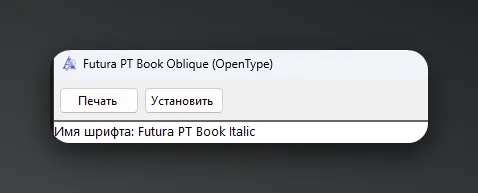
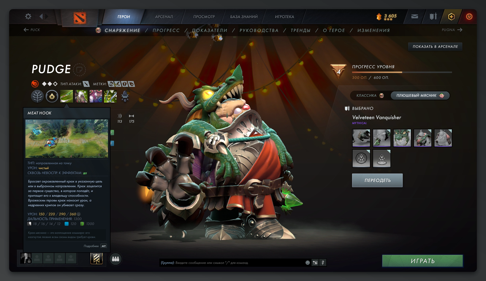

# Установка кастомного шрифта в Dota 2

Данный гайд представляет собой улучшенную версию [моего руководства из Steam](https://steamcommunity.com/sharedfiles/filedetails/?id=2976229318).

> **Примечание:** В гайде используется два шрифта — *Futura PT Medium Italic* и *Futura PT Book Italic*. Вы можете использовать любые другие шрифты по собственному желанию.

---

### Пошаговая инструкция

**1. Скачиваем нужные шрифты**  
В примере используются шрифты семейства [Futura PT](https://fontsme.com/futura-pt.font).

**2. Переименовываем файлы шрифтов**  
* Для заголовков Dota 2 использует имя: `reaver-bold.otf`
* Для основного текста: `radiance-regular.otf`

> *Совет:* Вы можете заменить только шрифт обычного текста. В таком случае в 5-м шаге достаточно оставить только правила для Radiance.

**3. Удаляем дефолтные шрифты Dota 2**  
Переходим по пути:  
`dota 2 beta\game\dota\panorama\fonts`  
и удаляем все файлы, которые находятся в этой папке.

**4. Добавляем новые шрифты**  
Помещаем скачанные и переименованные файлы шрифтов в папку `fonts`.

**5. Настраиваем конфигурационный файл**  
Переходим в директорию:  
`dota 2 beta\game\core\panorama\fonts\conf.d`  
и открываем файл `42-repl-global.conf` в текстовом редакторе. Полностью очищаем его содержимое и вставляем следующий код:

```xml
<?xml version='1.0'?>
<!DOCTYPE fontconfig SYSTEM 'fonts.dtd'>
<fontconfig>

	<!-- ##Style: common -->

	<!-- Global Replacements - Active if set to true above -->
	<!-- Add your own replacements here -->
	<!-- Clone "match" blocks below for each replacement -->
	<match target="font">
		<test name="family">
			<string>Reaver</string>
		</test>
		<edit name="family" mode="assign">
			<string>Futura PT Medium Italic</string>
		</edit>
	</match>
	<match target="pattern">
		<test name="family">
			<string>Reaver</string>
		</test>
		<edit name="family" mode="prepend" binding="strong">
			<string>Futura PT Medium Italic</string>
		</edit>
	</match>

	<match target="font">
		<test name="family">
			<string>Radiance</string>
		</test>
		<edit name="family" mode="assign">
			<string>Futura PT Book Italic</string>
		</edit>
	</match>
	<match target="pattern">
		<test name="family">
			<string>Radiance</string>
		</test>
		<edit name="family" mode="prepend" binding="strong">
			<string>Futura PT Book Italic</string>
		</edit>
	</match>
	
</fontconfig>
```

> **Откуда брать системные имена шрифтов?**  
> Откройте файл скачанного шрифта двойным кликом — точное название указано в поле **«Имя шрифта»** (Font name). Именно его нужно вписать вместо `Futura PT ...` в коде выше, если вы используете собственный шрифт.



**6. Запуск игры**  
После выполнения всех шагов заходим в Dota 2 и проверяем результат!


